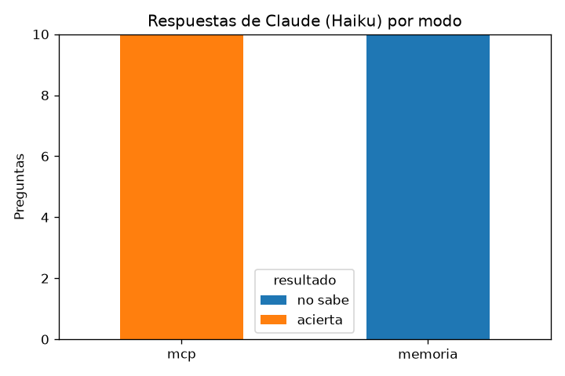

# Informe · MCP del BCRP

Evaluación con `uv run evaluar.py` (modelo Haiku, 10 preguntas: 8 del curso y 2 propias).

## 1. Resultados

| Modo | Acierta | Se equivoca | No sabe | Segundos promedio |
|---|---|---|---|---|
| memoria | 0 | 0 | 10 | 4.3 |
| mcp | 10 | 0 | 0 | 7.7 |

## 2. Qué falló cada modo y por qué

**Memoria:** no respondió ninguna de las 10 preguntas. En las 10, la columna `fuente` dice que no tiene acceso a
internet ni a la API del BCRP en esa sesión, y en varias aclara que su conocimiento llega hasta junio de 2026, así que
no puede saber cifras posteriores. Como la instrucción le permitía responder `null`, prefirió decir «no sé» antes que
estimar: no inventó ninguna cifra, pero tampoco sirve para responder.

**MCP:** acertó las 10, con diferencias menores a la tolerancia. Cada respuesta cita en `fuente` el código de la serie,
el periodo y la URL de la API del BCRP (las 10 incluyen `https://estadisticas.bcrp.gob.pe`), así que cualquier cifra se
puede verificar. Tarda más (7.7 s contra 4.3 s, y 4.4 turnos en promedio contra 2) porque primero busca el código con
`buscar_series` y luego pide los datos con `serie` o `resumen`, y cada llamada consulta la API del BCRP. Las cuentas
las hace Python en el servidor, no el modelo.

## 3. Mis dos preguntas

| id | Serie | Periodo | Verdad (web) | Memoria | MCP |
|---|---|---|---|---|---|
| azucar_dic25 | PN38776BM · Azúcar, precio de exportación (US$/t) | dic-2025 | 676.6 | no sabe | 676.61 ✅ |
| trigo_oct25 | PN01661XM · Trigo EE.UU., cotización (US$/t) | oct-2025 | 214 | no sabe | 214.22 ✅ |

Elegí estas 2 variables porque quería saber información relacionada a comercio exterior.

## 4. Dos cifras comprobadas a mano en la web del BCRP

| Serie | Periodo | Mi MCP | Web del BCRP | Link |
|---|---|---|---|---|
| PN38776BM | dic-2025 | 676.61 | 676.6 | https://estadisticas.bcrp.gob.pe/estadisticas/series/mensuales/resultados/PN38776BM/html |
| PN01661XM | oct-2025 | 214.22 | 214 | https://estadisticas.bcrp.gob.pe/estadisticas/series/mensuales/resultados/PN01661XM/html |

Las diferencias son solo de redondeo: la tabla web del BCRP muestra la cifra redondeada (676.6 y 214), mientras que la
API devuelve más decimales (676.61 y 214.22). Ambas diferencias quedan dentro de la tolerancia definida en
`preguntas.csv` (5 US$/t para el azúcar y 2 US$/t para el trigo), por eso `evaluar.py` las califica como aciertos.

## 5. Experimento extra: sin salida fácil

**Qué cambié:** borré de `INSTRUCCION` en `evaluar.py` la frase «Si no puedes saberlo con certeza, pon valor null:
no estimes.» y volví a correr la evaluación (`resultados_experimento.csv`). Después restauré la frase, para que
`uv run evaluar.py` reproduzca `resultados.csv`.

**Hipótesis (antes de correrlo):**

1. Sin la frase, ¿Claude seguirá diciendo «no sé» o dará números?
   Dará números porque podría entender que debe responder algo y buscará algo aproximado tal vez.
2. Si da números, ¿cuántos de los 10 crees que acertará? ¿En cuáles es más probable que acierte?
   5, es posible que se acerque si busca la misma variable en otros años ya que puede ser una variable con cifras
   similares en el mismo periodo o por periodos cercanos podría inferir.
3. ¿Por qué lo crees?
   Porque es lo que podría hacerse para proyectar valores, se toma como referencia valores históricos entre otras
   variables, pero sirve de referencia.

**Resultado:**

| Modo memoria | Acierta | Se equivoca | No sabe | Segundos promedio |
|---|---|---|---|---|
| Base (con la frase) | 0 | 0 | 10 | 4.3 |
| Sin la frase | 0 | 1 | 9 | 5.0 |

La única cifra que dio fue el PBI 2025: **3.2 %** contra **3.43 %** oficial (tolerancia 0.05), y en `fuente` dijo que
era «una cifra de memoria, no verificada». El modo MCP siguió acertando 10 de 10.

**Comparación con la hipótesis:** se cumplió solo en parte. Esperaba que diera números y acertara 5, pero respondió
una sola pregunta y la falló. Coincidió en la forma: tal como suponía, estimó a partir de lo que conocía de periodos
cercanos («corresponde aproximadamente… según las estimaciones del BCRP»). No coincidió en la cantidad: en las demás
siguió diciendo «no sé». Una explicación es que el PBI anual es una cifra muy citada, con proyecciones y noticias que
el modelo vio al entrenarse, mientras que el IPC de un mes de 2026, el tipo de cambio de un día exacto o el precio del
azúcar en diciembre de 2025 son demasiado específicos para estimarlos. El riesgo se vio igual: cuando estimó, la cifra
estaba equivocada, y sin comprobarla no habría forma de saberlo.

**Limitación:** el experimento quitó la frase de la instrucción, pero el esquema JSON de `evaluar.py` (línea 20) sigue
aceptando `"valor": null`, así que el modelo todavía tenía una forma de no responder. Además, al borrar la frase quedó
«…la pregunta.En «fuente»…» sin espacio, un detalle menor que no cambia el sentido.

## 6. Conclusión

Para una consulta puntual, que se resuelve rápido y en una web que ya se conoce, basta la búsqueda web. Cuando las
consultas se repiten o requieren más trabajo (varias series, periodos o cálculos), conviene construir un MCP: en esta
evaluación acertó 10 de 10, en 7.7 s por pregunta y con la fuente de cada cifra, mientras que en la prueba de clase la
búsqueda web acertó 7 de 8 y tardó 25.9 s por pregunta. Aun así, hay que conocer la fuente original para validar los
datos: el MCP es tan confiable como la API que consulta y el código que lo procesa, por eso comprobé dos cifras a mano
en la web del BCRP.